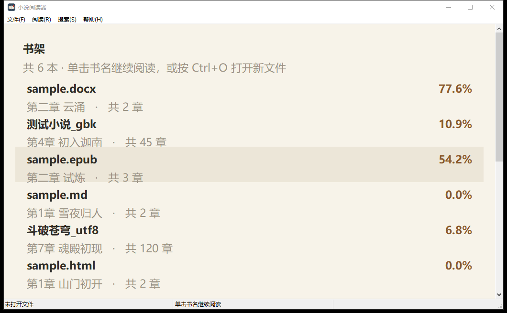
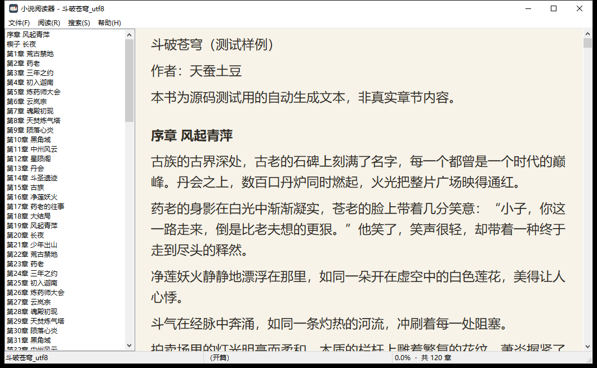
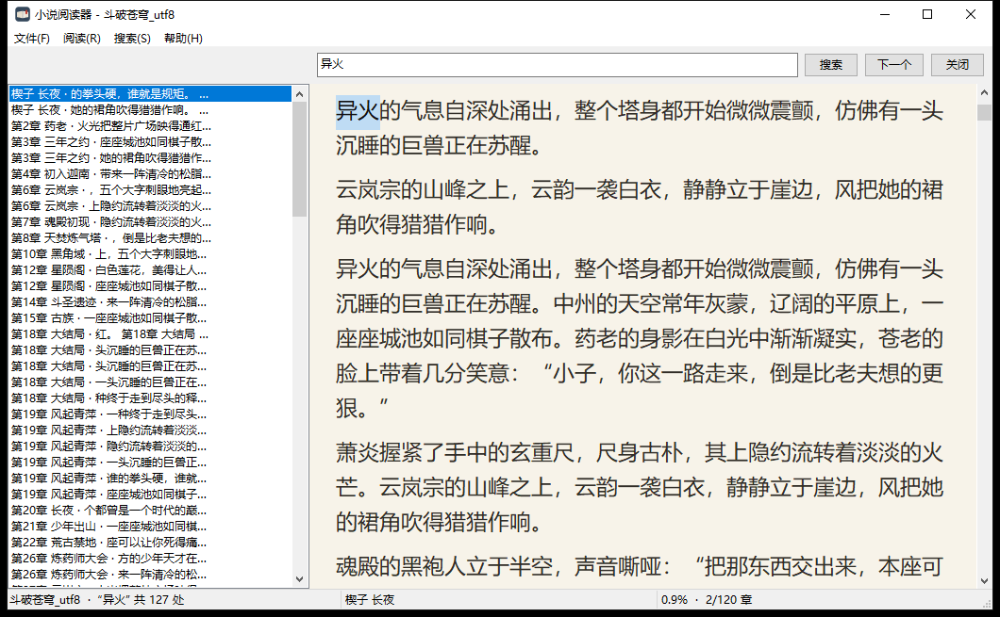
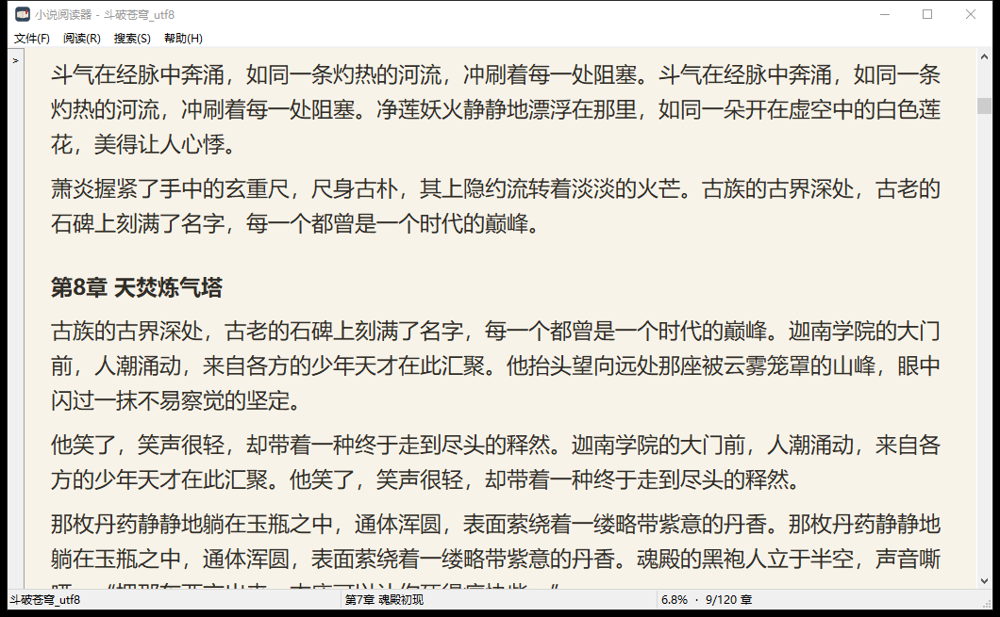
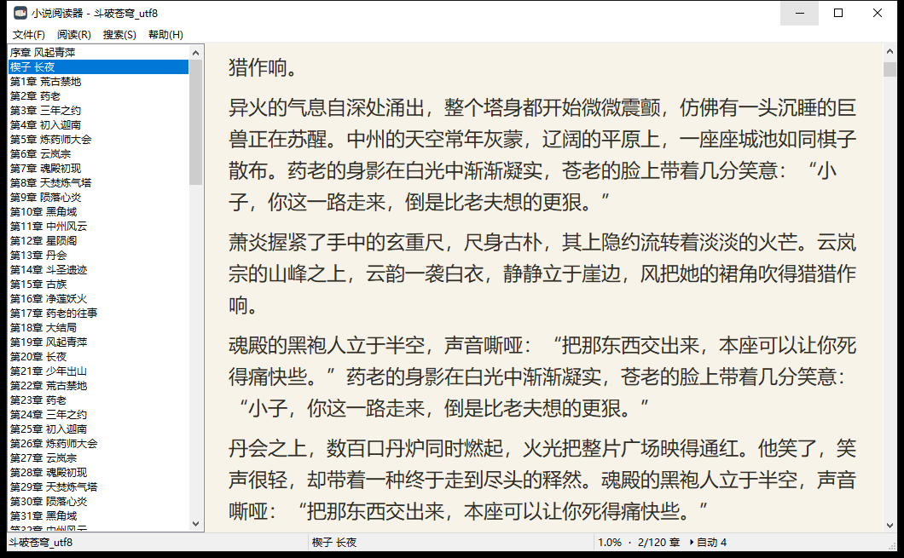
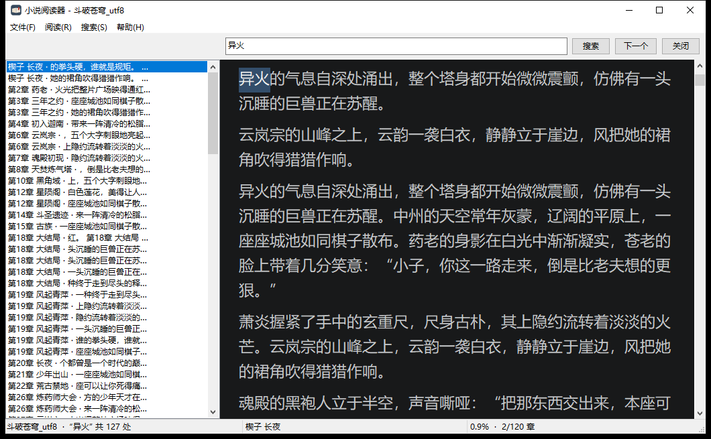
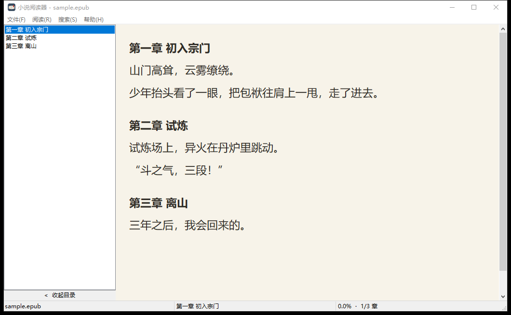
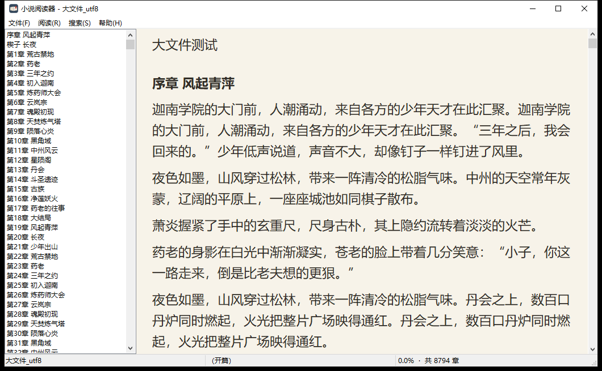
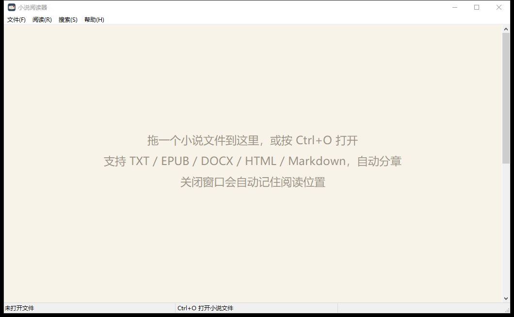

# 小说阅读器 · NovelReader

> 一个 **380 KB** 的 Windows 原生小说阅读器：纯 C++17 / Win32 手写，无第三方库，绿色单文件。
> 记住你读到哪一句，支持全文搜索、目录收放、自动下滑，还能直接读 **epub / docx / html / md**。


用 Electron / Qt 写个阅读器动辄几十兆，可我只是想看本小说。于是有了这个项目：只调用 Windows 自带的 API，正文自己画（不用 RichEdit），连 zip 解压（读 epub / docx）都是自己实现的，最终产物 380 KB —— 双击就能用，删掉即卸载，没有任何安装包和注册表写入。

*A 380 KB native Windows novel reader written in C++17 with the raw Win32 API — no third-party libraries, single portable exe. Remembers your reading position, full-text search, chapter TOC, auto-scroll, and reads txt/epub/docx/html/markdown.*

---

## 目录

- [下载与运行](#下载与运行)
- [特性](#特性)
- [截图](#截图)
- [快捷键](#快捷键)
- [支持的格式](#支持的格式)
- [分章规则](#分章规则)
- [自己编译](#自己编译)
- [仓库结构](#仓库结构)
- [实现要点](#实现要点)
- [性能参考](#性能参考)
- [常见问题](#常见问题)

---

## 下载与运行

**方式一：直接下成品**

- 本仓库里就带了一份编译好的：[`dist/NovelReader.exe`](dist/NovelReader.exe)（388,608 字节）
- 或者到 [Releases](../../releases) 下 `NovelReader-1.0.0-win64.zip`（exe + 使用说明 + 各格式示例书）

**方式二：自己编译**（见 [自己编译](#自己编译)，几分钟）

**第一次使用**

1. 双击 `NovelReader.exe`，首页就是书架（第一次是空白欢迎页）；
2. 把小说文件拖进窗口，或按 `Ctrl+O` 选择文件；
3. 读完关掉窗口即可 —— 下次打开会回到这一句；
4. 想换书：`Ctrl+W` 关掉当前书回到书架，点另一本；书架会显示每本读到第几章、百分之多少。

阅读进度和书架都保存在 exe 同目录的 `NovelReader.ini`（目录不可写时退到 `%APPDATA%\NovelReader\NovelReader.ini`，实际路径可在「帮助 → 关于」里看到）。**删掉这个 ini 就是清空所有记忆**；把 exe 和 ini 一起拷到别的电脑，进度也跟着走。

> 绿色软件：不写注册表、不装服务、不联网。

---

## 特性

| 功能 | 说明 |
| --- | --- |
| 🪶 **体积小** | 单个 `NovelReader.exe`，**380 KB**，静态链接 C++ 运行库，不需要任何 DLL |
| 📚 **首页书架** | 打开就看见读过哪些书、**读到第几章、进度百分比**，单击书名直接续读 |
| 📖 **记忆阅读位置** | 关掉窗口再打开，自动回到上次那本书、那一句话；换字号、缩放窗口也不会跑偏 |
| 🔍 **全文搜索** | 搜章节名或任意关键词，全书命中列表在左侧，点一下直接跳过去，`F3` 逐个翻 |
| 📑 **自动分章** | 认识「第12章」「第一章」「第001章」「第 12 章」「第一百二十三章」「第3回」「第5节」「第7卷」「序章」「楔子」「番外」「终章」「Chapter 5」等写法，并自动排除「第三回合」「他说：第一章我没看。」这类误判 |
| 🗂️ **目录收放** | 点侧栏底部「收起目录」或按 `Ctrl+T`，目录收成左边缘一条细条，正文独占全宽；再点一下展开 |
| 📦 **多格式** | `.txt` `.epub` `.docx` `.html` `.htm` `.md`，以及任意扩展名的纯文本；epub 按 OPF spine 顺序拼章节，docx 抽 `word/document.xml` 段落 |
| 🐌 **自动下滑 + 调速** | 手离开键盘也能读：`F6` 开关，`F7`/`F8` 在 1~10 级之间调速（约 3 秒一行 ~ 0.3 秒一行），级别会被记住 |
| 🔤 **编码自动识别** | UTF-8 / UTF-8 with BOM / UTF-16 LE / BE / GBK / GB18030 / 系统 ANSI，中文老书不乱码 |
| 🚀 **大文件不卡** | 懒排版 + 只绘制可见行；实测 14.7 MB / 8794 章的书打开不到 1 秒 |
| 🌙 **日间 / 夜间** | 米色纸和深色两套配色，`F2` 一键切换 |
| 🖱️ **拖拽打开 / 最近打开** | 把文件拖进窗口就行；文件菜单保留最近 10 本 |
| 🔒 **单实例** | 重复双击不会开第二个窗口抢进度，而是把文件交给已开的窗口并提到前台 |
| 💾 **绿色** | 所有状态存在 exe 旁边的 `NovelReader.ini`，整个文件夹拷走就能带走进度 |
| 🀄 **源码全中文注释** | 11 个源文件、约 6,000 行，注释写了"为什么这么做"，不是只写"做了什么" |

---

## 截图

**首页书架**（书名 + 读到第几章 + 百分比，单击续读）



**阅读界面**（左侧章节目录，底部状态栏显示进度 / 当前章节 / 全书章数）



**全文搜索**（127 处命中，关键词用【】标出，点击跳转并高亮）



**目录收放**（收起后正文独占全宽，左边缘留一条细条，点一下展开）



**自动下滑**（状态栏右侧显示当前速度 `▸自动 4`）



**夜间模式**



**EPUB**（自己写的 inflate，按 OPF spine 顺序拼章节）



**大文件**（8794 章也能秒开，目录直接列全）



**空白欢迎页**



---

## 快捷键

| 按键 | 功能 | 按键 | 功能 |
| --- | --- | --- | --- |
| `Ctrl+O` | 打开文件 | `Ctrl+W` | 关闭当前书，回到书架 |
| `Ctrl+F` | 全文搜索 | `F3` | 下一个搜索结果 |
| `Esc` | 关闭搜索条 | `F5` | 重新载入当前文件 |
| `F6` | 自动下滑开关 | `F7` / `F8` | 减速 / 加速 |
| `F2` | 日间 / 夜间 | `Ctrl+T` | 显示 / 隐藏目录 |
| `Ctrl+=` / `Ctrl+-` | 放大 / 缩小字号 | 行距 | 菜单「阅读 → 切换行距」 |
| `↑` `↓` `PgUp` `PgDn` `空格` | 滚动 / 翻页 | `Home` / `End` | 全书首尾 |
| `←` / `→` | 上一章 / 下一章 | `Ctrl+C` / `Ctrl+A` | 复制 / 全选 |

> 手动滚动、翻章、搜索跳转都会自动停下自动下滑；也可以再按一次 `F6` 自己停。

---

## 支持的格式

| 扩展名 | 怎么读 | 备注 |
| --- | --- | --- |
| `.txt`（及任意扩展名） | 直接按编码识别后当纯文本 | 不限扩展名，`.log` `.md` 之外的纯文本也能开 |
| `.html` `.htm` | 先按编码识别解码，再剥标签 | `<script> <style> <head> <title>` 整段跳过，实体（`&ldquo;` 等）还原 |
| `.md` `.markdown` | 剥掉 Markdown 记号 | `#` 标题变成章名，列表 / 引用 / 加粗 / 斜体记号去掉 |
| `.epub` | 解析 zip → `META-INF/container.xml` → OPF → 按 spine 顺序取 XHTML → 剥标签 | 不支持 DRM；纯图片章节抽不出文字 |
| `.docx` | 解析 zip → `word/document.xml` → 取 `<w:p>` / `<w:t>` / `<w:br>` / `<w:tab>` | 只取正文，表格按行拼接；图片忽略 |
| `.pdf` `.mobi` `.azw3` | **不支持** | PDF 是排版格式，mobi/azw3 不是 zip 容器，都要另写引擎（见 [常见问题](#常见问题)） |

多格式的产物统一是"纯文本 + 空行分段"，所以分章、搜索、记忆位置、书架这些功能一份代码吃到底。

---

## 分章规则

程序逐段检查，满足以下任一条件即视为章节标题（要求一行 ≤ 60 字且不含句号）：

1. **中文序号**：`第` + 数字 + 单位字，单位字为 `章节回卷集篇幕话`
   - `第1章 少年出山`、`第一章`、`第001章`、`第 12 章`、`第一百二十三章`、`第3回`、`第5节`、`第7卷`、`第十二篇`
   - 排除了 `第三回合`、`第三节课`、`第二篇幅` 这类正文写法
2. **特殊标题词**：`序章` `序言` `楔子` `引子` `前言` `后记` `尾声` `终章` `番外` `外传` `正文` `大结局` `结局` `附录` `完本感言` `作品相关`
3. **英文**：`Chapter 1`、`CHAPTER 12`、`chapter.3`

epub / docx / html / md 会先被抽成纯文本（Markdown 的 `#` 去掉、HTML 标签剥掉、docx 段落按 `<w:p>` 分），再走同一套分章规则 —— 所以 epub 里 `<h1>第3章 试炼</h1>` 一样能进目录。

认不出来？说明这本书的标题写法比较特殊，可以改 `src/book.cpp` 里的 `IsChapterLine()`（注释里写清了每一道判定）。

---

## 自己编译

只需要一个 MinGW 工具链（本项目用 [LLVM-MinGW](https://github.com/mstorsjo/llvm-mingw)，MSYS2 的 g++ 也可以；用 MSVC 需自己改命令行）：

```bat
:: 1. 改 build.bat 第 9 行，把 BIN 指向你的工具链 bin 目录
set BIN=D:\llvm-mingw\bin

:: 2. 在仓库根目录执行
build.bat
```

产物在 `build\NovelReader.exe`。

编译参数都在 `build.bat` 里，几个关键点：

- `-mwindows -municode`：不带控制台窗口，入口是 `wWinMain`
- `-static -static-libgcc -static-libstdc++`：静态链接，免装运行库 —— 这是 380 KB 的来源
- `-ffunction-sections -fdata-sections -Wl,--gc-sections -Wl,-s`：去掉没用的代码和符号表
- `windres` 先把图标和 manifest 编成 `.res` 再链接（`.rc` 里的路径相对当前目录，所以脚本先 `cd` 到仓库根）

`build_dbg.bat` 会额外带上 `-DNR_TRACE`，编出带日志的调试版：程序运行时把关键事件写进 `nr_trace.log`（排版、锚点恢复、搜索、定时器、命令分发都有记录），排查问题很方便。

---

## 仓库结构

```
.
├── src/                 源码（11 个文件，约 6,000 行，全中文注释）
│   ├── ids.h            命令 / 控件 / 资源 ID
│   ├── common.h         公共声明：Book / Chapter / Settings / ShelfItem 与各模块接口
│   ├── book.cpp         打开文件：编码识别、多格式分派、正文规范化、段落与章节索引、全文搜索
│   ├── format.h/.cpp    抽取纯文本：HTML / Markdown 去标记、docx 取 w:p、epub 走 OPF spine
│   ├── zip.h/.cpp       zip 解析 + DEFLATE 解压（RFC 1951，自己写的，不依赖 zlib）
│   ├── ini.cpp          读写 ini：设置、每本书的进度元数据、最近打开、书架数据源
│   ├── view.cpp         自绘阅读视图：首页书架、排版、绘制、滚动、选中、目录折叠条
│   ├── ui.cpp           主窗口：菜单、目录、搜索条、状态栏、命令分发、自动下滑、单实例
│   └── trace.cpp        调试日志（仅在 -DNR_TRACE 时编译）
├── res/                 资源：app.rc（图标 + manifest）、app.manifest、app.ico
├── examples/            各格式示例书，可直接拿来试（含 GBK 与 UTF-8 两种编码）
├── screenshots/         截图
├── tools/               开发用脚本
│   ├── make_icon.py     生成多尺寸 .ico（Pillow）
│   ├── make_test_books.py  生成测试用 txt（含章节标题、关键词样本）
│   ├── ziptest.cpp      zip / inflate 自测（对照 .NET 与 zlib 生成的向量）
│   └── loadtest.cpp     控制台版加载自测：打印字符数 / 段数 / 章数 / 搜索命中
├── dist/                成品 exe（发版用）
├── build.bat            一键编译
├── build_dbg.bat        编译带 trace 的调试版
└── README.md
```

模块之间的调用方向很干净：`ui.cpp` 负责交互，`book.cpp` 负责数据，`view.cpp` 负责显示，`ini.cpp` 负责持久化，`format.cpp` / `zip.cpp` 是 `book.cpp` 的下游（把非纯文本抽成纯文本），彼此只通过头文件里的声明打交道。

---

## 实现要点

**为什么不用 RichEdit / Edit 控件显示正文？**
几 MB 的文本灌进 RichEdit，装载要好几秒，内存也翻倍，滚动手感还发涩。这里自己画：每段按宽度切成视觉行，缓存每段的行数（懒计算），只绘制屏幕上可见的几十行，滚动时改的是"顶行是第几段第几行"。所以 15 MB 的书滚动照样跟手。

**阅读位置为什么记"字符偏移"而不是行号？**
行号依赖字号和窗口宽度，换个字号就全错位了。记字符偏移，配合排版时反算（`BookCharToPara` + 段落内行号），就能精确回到同一句话。窗口尺寸变化时用 `RestoreAnchorFromOffset()` 重新校准，所以调整字号不会跳行。

**编码识别顺序**
`BOM` → `无 BOM 的 UTF-16LE`（判据：奇数位字节 3/4 以上是 0）→ `严格校验通过的 UTF-8` → `GB18030` → `GBK` → `系统 ANSI`。
自己写 UTF-8 校验而不是直接交给 `MultiByteToWideChar`，是因为它对非法字节"宽容替换"而不报错，GBK 文本会被转成一堆 `U+FFFD`，必须自己先判。

**多格式是怎么塞进 380 KB 的？**
没有引入 zlib，也没有额外链接任何压缩库：`zip.cpp` 自己读中央目录、自己实现 RFC 1951 的 stored / fixed Huffman / dynamic Huffman 三种块，重叠回溯逐字节拷贝（内存不能用 `memcpy`）。EPUB 只取 `container.xml → OPF → manifest/spine`，DOCX 只认 `word/document.xml` 里的 `<w:p>/<w:t>/<w:br>/<w:tab>`。抽出纯文本之后，分章、搜索、记忆位置全都复用 txt 那套逻辑，一份代码走到底。

**ini 为什么先写一个 BOM？**
`WritePrivateProfileStringW` 判断"是不是 Unicode 文件"看的是文件大小：文件不存在或大小为 0 时它按 ANSI 写，中文路径就被系统代码页吃了。所以在文件为空时先写一个 UTF-16LE BOM，之后所有写入才是 Unicode。

**为什么限制单实例？**
两个进程同时开着会互相覆盖同一个 ini —— 谁后关窗谁赢，用户会看到"进度莫名回退"。所以第二个实例只做一件事：把命令行里的文件用 `WM_COPYDATA` 交给已有窗口，然后退出。

**首页书架的数据从哪来？**
就是 ini 里的 `[recent]` 段加上每本书自己的段（`chname` / `ch` / `chn` / `pct` / `title`），所以书架天生按"最近阅读"倒序，不需要另存一份书单；文件被删或改名时用 `GetFileAttributesW` 判断并灰掉。

**源码注释**
11 个源文件全部中文注释，注释率 25%~40%，重点写"为什么"：为什么 UTF-8 要自己校验、为什么 ini 要先写 BOM、为什么行号不能当锚点、为什么 zip 的重叠回溯不能用 `memcpy`、为什么箭头要用半角 `<` `>`（系统界面字体没有 `‹›` 字形）。改代码前建议先读文件头那段总述。

---

## 性能参考

本机实测（Windows 10 x64，机械硬盘）：

| 项目 | 数据 |
| --- | --- |
| exe 体积 | 388,608 字节（380 KB） |
| 冷启动到窗口出现 | < 100 ms |
| 打开 120 章 / 21 万字 | 瞬间，无感 |
| 打开 14.7 MB / 8794 章 | < 1 秒（进程启动到目录列全 789 ms） |
| 全文搜索 21 万字 | 毫秒级，127 处命中照样秒出 |
| 解压 epub / docx | 几毫秒（只解需要的条目） |
| 内存占用（15 MB 的书） | 约 60 MB（正文 UTF-16 + 段落索引 + 行数缓存） |

---

## 常见问题

**Q：中文乱码怎么办？**
程序会依次尝试多种编码。如果还是乱码，多半是这本书被人工编辑过、混了多种编码。可以用记事本另存为 UTF-8 再试。

**Q：进度丢了？**
先看 exe 旁边有没有 `NovelReader.ini`。如果没有，说明该目录不可写（例如放在了 `C:\Program Files` 下），进度存到了 `%APPDATA%\NovelReader\NovelReader.ini`，在「帮助 → 关于」里能看到实际路径。

**Q：没有识别出章节？**
你的文件里章节标题可能不符合上面列的写法。打开 `src/book.cpp` 的 `IsChapterLine()`，按注释加一条规则重新编译即可（识别不出章节也不影响阅读，只是按段落翻）。

**Q：能看 PDF / mobi / azw3 吗？**
不能。PDF 是排版格式而不是文字流，完整支持等于内置一套渲染引擎；mobi/azw3 用的是 PalmDOC/KF8 而不是 zip 容器 —— 两者都会让体积翻几倍，与"380 KB 单文件"的目标冲突。epub / docx / html / md / txt 都可以。

**Q：epub 打开是空的？**
只支持标准 epub（zip + OPF + XHTML 章节）。DRM 加密的、或者章节内容是图片扫描件的，抽不出文字，这类书会明确提示"这个文件里没有可显示的正文"。

**Q：能多开几本书吗？**
同一时间只打开一本（第二本会替换第一本）；书架上可以随时切换，进度各记各的。

**Q：为什么只有一个 .exe，没有安装程序？**
故意的。不需要安装、不需要管理员权限、不写注册表，拷到哪里都能跑，不想要了直接删。

---

## 反馈

发现某本书章节识别不出来、或者有格式解析出错，欢迎开 [Issue](../../issues) 并附上能复现的那几行（或者文件片段），我会把规则补进去。

---

## 协议

[MIT](LICENSE) —— 随便用、随便改，出了事别找我。
